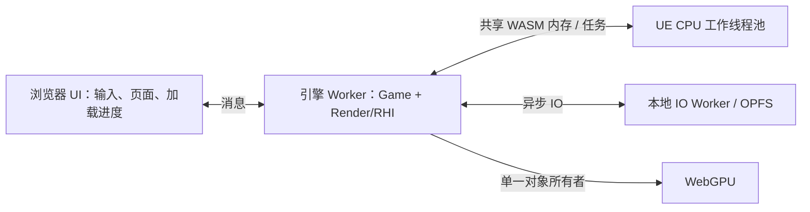

# Web 桌面运行时多线程调研

日期：2026-10-27。

## 结论与当前状态

可以支持真正的 WASM 共享内存多线程。现有 wasm64 pthread 样例已在本机 Chrome 156.0.8078.48、Edge 156.0.4314.42 运行通过，包括两个线程的原子计数，以及 Worker 内 WebGPU 绘制、计算、回读、画布缩放和横竖屏像素校验。

正式 UE 页面目前仍是单线程引擎，另有本地 IO Worker。本轮增加可复现的能力及性能探针，没有把普通 UE 运行时改成多线程；样例通过不能作为 UE 线程移植完成的依据。

多线程对当前别墅值得投入，但不能承诺等比例加速。默认关卡的 4K GPU 像素工作也需要单独优化。

## 实际单线程证据

| 层级 | 当前实现 | 意义 |
| --- | --- | --- |
| 构建 | 普通 UBT WebToolChain 编译/链接未启用 `-pthread`，正式链接响应也未包含它 | WASM 线性内存不是共享内存 |
| Core | `FWebPlatformProcess::SupportsMultithreading()` 固定返回 false | UE 不启动正常多线程调度 |
| 核心数 | Web 未覆盖 `FGenericPlatformMisc::NumberOfCores()` 的默认值 1 | 不能按浏览器逻辑核心数创建合理任务池 |
| 线程创建 | GenericPlatformProcess 在 Web 排除了 `FRunnableThreadPThread` 创建分支 | 仅改能力返回值仍不能创建 UE 工作线程 |
| 事件 | Core 在不支持多线程时创建 `FSingleThreadEvent` | 需要验证真实事件等待、唤醒和退出 |
| 引擎入口 | `StartEngine()` 固定追加 `-onethread -norhithread` | 游戏、渲染准备及 RHI 调用按串行路径运行 |
| RHI | 关闭 RHIThread、并行 RHI 执行及多线程资源创建，`RequireOwner()` 检查单一线程 | 不能直接打开 UE 的所有渲染并行开关 |
| 运行时 | 页面实际 `HEAPU8.buffer instanceof SharedArrayBuffer === false` | 与构建及平台实现一致 |
| 本地 IO | 实际观察到 `web-content-worker.js`，其结果异步返回引擎线程 | 不是“整个浏览器只有一个线程”，也不是 UE 多线程 |

`MaxParallelActions` 是构建并发数，不会改变上述运行时状态。`PLATFORM_USE_PTHREADS=1` 只是启用了若干 pthread 平台接口；TLS、锁能使用不等于工作线程已经接入。

主要源码：

- `reference-engine/Engine/Platforms/Web/Source/Programs/UnrealBuildTool/WebToolChain.cs`
- `reference-engine/Engine/Platforms/Web/Source/Runtime/Core/Public/Web/WebPlatformProcess.h`
- `reference-engine/Engine/Platforms/Web/Source/Runtime/Core/Public/Web/WebPlatformMisc.h`
- `reference-engine/Engine/Source/Runtime/Core/Private/GenericPlatform/GenericPlatformProcess.cpp`
- `reference-engine/Engine/Source/Runtime/Core/Private/GenericPlatform/GenericPlatformMisc.cpp`
- `tests/ue-web-smoke/Source/UEWebEngine/Private/UEWebEngine.cpp`
- `tests/ue-shader-host/Plugins/WebGPUShader/Source/WebGPURHI/Private/WebGPUDynamicRHI.cpp`

## 浏览器与工具链条件

本机的隔离服务已经发送 COOP/COEP，实测 `crossOriginIsolated` 和 `SharedArrayBuffer` 均可用。现有 `build-web.ps1` 的 `abi64-thread`、`gpu64-thread` 使用 `-pthread`、预建线程池和 `PROXY_TO_PTHREAD`；GPU 版本另转移 OffscreenCanvas。两浏览器的三个检查均通过：ABI 一次、GPU 横竖屏各一次，原子计数为 20000，真实 GPU 回读及画布像素正确。

Emscripten 官方要求在编译各个 C/C++ 源文件和最终链接时均启用 `-pthread`。因此不能只在最后链接时加参数，必须生成单独的共享内存对象及依赖库。线程版和单线程版也应是独立产物，通过能力和构建清单选择。

UE 会同步等待线程初始化、事件和任务完成，浏览器 UI 线程不适合作为这种阻塞链的中心。推荐采用 Worker 中的引擎入口；DOM、焦点和指针锁定留在 UI 线程，以消息或受控代理通信。

官方参考：

- [Emscripten pthreads](https://emscripten.org/docs/porting/pthreads.html)：编译/链接、预建池、`PROXY_TO_PTHREAD`、UI 线程阻塞及内存增长。
- [Dawn Emdawnwebgpu](https://dawn.googlesource.com/dawn/+/refs/heads/main/src/emdawnwebgpu/README.md)：当前采用的 C/C++ WebGPU 桥接方案。

固定 SDK 的本地 Emdawn 实现将 JS GPU 对象保存在每个 JS 执行环境的 `WebGPU.Internals.jsObjects` 中。共享 WASM 指针不会自动让另一个 Worker 获得同一个 JS GPU 对象。当前 RHI 所有权检查有实际保护作用，不能为了启用线程删除它。

## 关卡实测

探针在原发布页启用诊断用 GPU timestamp，保持原画质、曝光、材质、流送和相机。默认关卡按 1080p→4K→4K→1080p 测量，以降低单向预热造成的偏差；每档测量三秒 CPU 回调、抽样五帧 GPU。不同浏览器及关卡顺序运行。

最终定向复测的量级如下，默认关卡含 Chrome/Edge 两浏览器，别墅为 Chrome：

| 场景 | CPU 每帧同步回调 | GPU 通道时间合计 |
| --- | --- | --- |
| 默认关卡，1920×1080 | 约 6.7～7.4ms | 约 2.6～3.2ms |
| 默认关卡，3840×2160 | 约 7.0～7.4ms | 约 8.8～9.6ms |
| 别墅当前出生视角，1920×1080 | 约 46.4ms | 约 5.3～5.7ms |

默认关卡的 GPU 耗时随实际像素数明显增长，多线程不会直接减少这部分着色成本。别墅的 CPU 侧回调远高于 GPU 通道时间，值得进一步拆分可见性、绘制准备、资源处理和 WebGPU 命令编码的成本。

这些数字不能直接相加，也不是独立的 UE `Game`/`Draw` CPU 计时。CPU 统计覆盖完成一帧的同步 RAF 回调，包含 WASM、JS 编码和提交开销；GPU 通道合计不包含所有拷贝及空隙。GPU 首尾跨度还可能包含提交不足形成的等待。headless、API 包装、其他桌面 GPU 使用及五帧抽样都会影响数值；较早的 Edge 4K 抽样曾有明显波动，不能当作稳定耗时上限。CPU 时间较高不代表全部工作可以并行，串行 API 调用仍可能占较大比例。

别墅 4K 的首次诊断在第一组 1080p 之后未完成，十分钟后终止了该测试及其浏览器子进程，没有获得有效 4K 数据；具体卡住的操作未隔离，不能据此认定线程、显存或渲染器是根因。探针随后补充 CPU/GPU 采样超时保护，1080p 两轮定向测量通过。

## 推荐接入顺序

### 第一阶段：独立线程候选与 UE Core

创建与现有正式包分开的线程候选，先完整编译 Core 和所需库的共享内存版本。将多线程能力绑定到真实线程构建宏，补齐有界核心数、真实 runnable 创建、事件及线程退出；从 2～4 个 CPU 工作线程起步，避免按 32 个逻辑核心直接创建所有 UE 常驻线程。

先验收真实 `FRunnableThread`、TLS 隔离、锁竞争、事件超时/唤醒、线程 join、并发 UE 分配器和内存增长，再验证 UE TaskGraph/Tasks 的并行执行及关闭。已有 ABI 原子计数只能证明底层能力，不能代替这些检查。

### 第二阶段：完整引擎驻留 Worker



先保持一个 GPU 所有者，将 CPU 任务交给池执行。迁移工作包括 OffscreenCanvas、DOM 输入转发、缩放、指针锁定、焦点、FS 装载、进度/诊断状态和本地 IO 回调。当前 `EM_ASM` 的 `globalThis` 状态、直接调用 `Module._Web...` 的测试接口，以及 IO 请求表均假定一个执行环境，需要明确归属。

`WebPlatformFile.cpp` 的 `LocalReads`/请求编号和回调没有跨线程同步，不能允许任何工作线程直接触碰它们。任务产生的 IO 请求需要路由至所属线程，完成通知也需在正确线程分发。内存增长后外部 JS 的 HEAP 视图更新应纳入回归。

此阶段主要目标是页面响应、CPU 任务并行和可控的运行结构；只把同一串行循环搬到 Worker 不等于提高帧率。

### 第三阶段：游戏与渲染线程分离

在独立 CPU 采样确定收益位置后，接入 UE 独立渲染线程，使 Game 与 Draw 可以流水运行；GPU 对象创建、使用、提交和最终释放始终路由到同一个渲染所有者。初始化阶段在游戏线程创建设备再直接让另一线程使用现有句柄，无法满足当前桥接实现。

进一步的独立 RHI 线程、并行命令列表及并发 GPU 资源创建留到单一所有者方案验证后。`GRHISupportsParallelRHIExecute` 等能力按实际实现开放，不一次性全置 true。

## 验收与边界

线程数或 Worker 数不能作为最终收益依据。默认关卡和别墅都应采用同包配置、同视角、同像素尺寸，测量 CPU 分段、GPU 通道、帧时间 p95、UI 响应和内存，并确认输出画面不变。还需覆盖纹理流送、快速缩放、鼠标/触屏、失焦、页面退出及重新加载、任务取消、长时间运行和设备丢失。

正式交付仍应保留当前单线程包的可恢复备份，线程候选通过完整 UE 运行及来源审计后再切换。不会因为多线程而降低桌面 SM5 材质目标；多线程也不等于引入 Lumen 或降低显存需求。

## 复现与证据

```powershell
$env:NODE_PATH = 'C:/Users/wap80/.cache/codex-runtimes/codex-primary-runtime/dependencies/node/node_modules'
$env:P0_RESULTS = 'threads-research-chrome-results.json'
node tests/web-platform/run-browser.cjs abi64-thread gpu64-thread
$env:P0_BROWSER = 'C:/Program Files (x86)/Microsoft/Edge/Application/msedge.exe'
$env:P0_RESULTS = 'threads-research-edge-results.json'
node tests/web-platform/run-browser.cjs abi64-thread gpu64-thread
Remove-Item Env:P0_BROWSER
node tests/web-platform/probe-web-threading.cjs --seconds=3
node tests/web-platform/probe-web-threading.cjs --browser=Edge --seconds=3
node tests/web-platform/probe-web-threading.cjs --project=triplex-house-villa --resolutions=1080,1080 --seconds=3
```

能力检查复用既有 P0 线程产物，测量探针记录其源码和产物哈希、运行结果、正式 UBT 链接响应、当前发布产物、实际共享内存状态、Worker URL 及原始 CPU/GPU 样本。

主要报告位于 `tests/web-platform/results/`：

- `threads-research-chrome-results.json`、`threads-research-edge-results.json`
- `web-threading-default-chrome-results.json`、`web-threading-default-edge-results.json`
- `web-threading-triplex-house-villa-chrome-results.json`
- `web-threading-villa-4k-interrupted.json`：人工记录的未完成诊断，不能当作 4K 性能证据。
