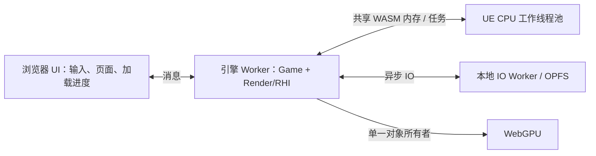

# Web 桌面运行时多线程调研

日期：2026-10-28。

## 结论与当前状态

可以支持真正的 WASM 共享内存多线程。现有 wasm64 pthread 样例已在本机 Chrome 156.0.8078.48、Edge 156.0.4314.42 运行通过，包括两个线程的原子计数，以及 Worker 内 WebGPU 绘制、计算、回读、画布缩放和横竖屏像素校验。

正式 UE 页面目前仍是单线程引擎，另有本地 IO Worker。独立 UE Core 线程候选和第二阶段完整默认关卡候选均已在 Chrome/Edge 验证通过：引擎驻留 Worker、共享内存 CPU 任务、本地流送、输入和 4K 尺寸可用。候选地址为 `http://127.0.0.1:8765/build/ue-default-template-threads/index.html`，原正式地址保持不变。尚未完成同条件性能收益测量，不宣称关卡帧率提升。

多线程对当前别墅值得投入，但不能承诺等比例加速。默认关卡的 4K GPU 像素工作也需要单独优化。

## 正式包的单线程证据

此表描述当前正式关卡包。源码已增加由 `UE_WEB_THREADS=1` 显式启用的独立候选路径，普通 Target 保持单线程。

| 层级 | 当前实现 | 意义 |
| --- | --- | --- |
| 构建 | 普通 UBT WebToolChain 编译/链接未启用 `-pthread`，正式链接响应也未包含它 | WASM 线性内存不是共享内存 |
| Core | 普通编译未定义 `__EMSCRIPTEN_PTHREADS__`，能力返回 false | UE 不启动正常多线程调度 |
| 核心数 | 普通编译返回 1；线程候选限定在 2～4 | 避免按本机全部逻辑核心创建任务池 |
| 线程创建 | 普通编译仍不创建 runnable；候选新增 Web pthread 实现 | 线程支持与实际编译内存模型绑定 |
| 事件 | Core 在不支持多线程时创建 `FSingleThreadEvent` | 需要验证真实事件等待、唤醒和退出 |
| 引擎入口 | `StartEngine()` 固定追加 `-onethread -norhithread` | 游戏、渲染准备及 RHI 调用按串行路径运行 |
| RHI | 关闭 RHIThread、并行 RHI 执行及多线程资源创建，`RequireOwner()` 检查单一线程 | 不能直接打开 UE 的所有渲染并行开关 |
| 运行时 | 页面实际 `HEAPU8.buffer instanceof SharedArrayBuffer === false` | 与构建及平台实现一致 |
| 本地 IO | 实际观察到 `web-content-worker.js`，其结果异步返回引擎线程 | 不是“整个浏览器只有一个线程”，也不是 UE 多线程 |

`MaxParallelActions` 是构建并发数，不会改变上述运行时状态。`PLATFORM_USE_PTHREADS=1` 只是启用了若干 pthread 平台接口；TLS、锁能使用不等于工作线程已经接入。

主要源码：

- `reference-engine/Engine/Platforms/Web/Source/Programs/UnrealBuildTool/WebToolChain.cs`
- `reference-engine/Engine/Platforms/Web/Source/Runtime/Core/Public/Web/WebPlatformProcess.h`
- `reference-engine/Engine/Platforms/Web/Source/Runtime/Core/Public/Web/WebPlatformMisc.h`
- `reference-engine/Engine/Source/Runtime/Core/Private/GenericPlatform/GenericPlatformProcess.cpp`
- `reference-engine/Engine/Source/Runtime/Core/Private/GenericPlatform/GenericPlatformMisc.cpp`
- `tests/ue-web-smoke/Source/UEWebEngine/Private/UEWebEngine.cpp`
- `tests/ue-shader-host/Plugins/WebGPUShader/Source/WebGPURHI/Private/WebGPUDynamicRHI.cpp`

## 浏览器与工具链条件

本机的隔离服务已经发送 COOP/COEP，实测 `crossOriginIsolated` 和 `SharedArrayBuffer` 均可用。现有 `build-web.ps1` 的 `abi64-thread`、`gpu64-thread` 使用 `-pthread`、预建线程池和 `PROXY_TO_PTHREAD`；GPU 版本另转移 OffscreenCanvas。两浏览器的三个检查均通过：ABI 一次、GPU 横竖屏各一次，原子计数为 20000，真实 GPU 回读及画布像素正确。

Emscripten 官方要求在编译各个 C/C++ 源文件和最终链接时均启用 `-pthread`。因此不能只在最后链接时加参数，必须生成单独的共享内存对象及依赖库。线程版和单线程版也应是独立产物，通过能力和构建清单选择。

UE 会同步等待线程初始化、事件和任务完成，浏览器 UI 线程不适合作为这种阻塞链的中心。推荐采用 Worker 中的引擎入口；DOM、焦点和指针锁定留在 UI 线程，以消息或受控代理通信。

官方参考：

- [Emscripten pthreads](https://emscripten.org/docs/porting/pthreads.html)：编译/链接、预建池、`PROXY_TO_PTHREAD`、UI 线程阻塞及内存增长。
- [Dawn Emdawnwebgpu](https://dawn.googlesource.com/dawn/+/refs/heads/main/src/emdawnwebgpu/README.md)：当前采用的 C/C++ WebGPU 桥接方案。

固定 SDK 的本地 Emdawn 实现将 JS GPU 对象保存在每个 JS 执行环境的 `WebGPU.Internals.jsObjects` 中。共享 WASM 指针不会自动让另一个 Worker 获得同一个 JS GPU 对象。当前 RHI 所有权检查有实际保护作用，不能为了启用线程删除它。

## 关卡实测

探针在原发布页启用诊断用 GPU timestamp，保持原画质、曝光、材质、流送和相机。默认关卡按 1080p→4K→4K→1080p 测量，以降低单向预热造成的偏差；每档测量三秒 CPU 回调、抽样五帧 GPU。不同浏览器及关卡顺序运行。

最终定向复测的量级如下，默认关卡含 Chrome/Edge 两浏览器，别墅为 Chrome：

| 场景 | CPU 每帧同步回调 | GPU 通道时间合计 |
| --- | --- | --- |
| 默认关卡，1920×1080 | 约 6.7～7.4ms | 约 2.6～3.2ms |
| 默认关卡，3840×2160 | 约 7.0～7.4ms | 约 8.8～9.6ms |
| 别墅当前出生视角，1920×1080 | 约 46.4ms | 约 5.3～5.7ms |

默认关卡的 GPU 耗时随实际像素数明显增长，多线程不会直接减少这部分着色成本。别墅的 CPU 侧回调远高于 GPU 通道时间，值得进一步拆分可见性、绘制准备、资源处理和 WebGPU 命令编码的成本。

这些数字不能直接相加，也不是独立的 UE `Game`/`Draw` CPU 计时。CPU 统计覆盖完成一帧的同步 RAF 回调，包含 WASM、JS 编码和提交开销；GPU 通道合计不包含所有拷贝及空隙。GPU 首尾跨度还可能包含提交不足形成的等待。headless、API 包装、其他桌面 GPU 使用及五帧抽样都会影响数值；较早的 Edge 4K 抽样曾有明显波动，不能当作稳定耗时上限。CPU 时间较高不代表全部工作可以并行，串行 API 调用仍可能占较大比例。

别墅 4K 的首次诊断在第一组 1080p 之后未完成，十分钟后终止了该测试及其浏览器子进程，没有获得有效 4K 数据；具体卡住的操作未隔离，不能据此认定线程、显存或渲染器是根因。探针随后补充 CPU/GPU 采样超时保护，1080p 两轮定向测量通过。

## 推荐接入顺序

### 第一阶段已实现：UE Core 线程候选

新增 `UEWebThreads` 独立 Target、模块、构建脚本及浏览器验证页。构建在编译和链接均启用 `-pthread`，并使用 `PROXY_TO_PTHREAD` 让程序入口运行在 Worker；浏览器主线程禁止阻塞等待。`UE_WEB_THREADS` 与编译器真实 pthread 宏不一致时直接编译失败。

Web runnable 复用 UE pthread 生命周期，默认工作线程栈 2 MiB，不请求浏览器不支持的 OS 优先级。核心数限定为 2～4，IO 工作线程建议数为 1。候选预建 8 个浏览器 Worker，线程池耗尽直接报错；这些是可复用的 pthread 容器，不表示存在 8 个活跃 UE CPU 任务线程。测试用三个调度线程，并限制超额订阅比例为 1。完整 Engine 后续需要根据常驻线程清单重新核定池容量。

`BLAKE3` 和 `libPNG` 构建脚本增加 `-Threads`，生成独立的 `wasm64-thread` 库和报告。UBT 按 Target 的线程定义选择，普通库、普通对象与线程版相互隔离。

本机 Chrome 156.0.8078.48、Edge 156.0.4314.42 各连续三轮通过 17 项真实 Core 检查：

- runnable 创建、事件超时/手动重置/自动重置、唤醒、锁竞争、不同线程 ID、线程 join、协作停止。
- 编译器 TLS 与 UE TLS slot 隔离，并发 UE 分配/重分配及内容校验。
- 在线程持有分配内容时，将共享内存从 64 MiB 扩到 128 MiB，随后在原线程继续分配并验证数据；浏览器 HEAP 视图同步更新。
- 两个 `UE::Tasks` 同时停在同步门上，证明运行在两个不同工作线程，且均不是游戏线程。另测批量任务、前置依赖、TaskGraph 后台派发。
- TaskGraph 关闭并重启后再次完成全部任务，最后在引擎 Worker 清理 C++ 全局对象，浏览器收到正常退出码 0。

六轮完整运行中的 UI 定时器最大间隔约 12ms（定时周期 10ms），包含引擎 Worker 阻塞等待。另测页面中断关闭后重新启动，以及缺少 COOP/COEP 时明确拒绝启动。单线程 Core 在 Node 和两浏览器保持非共享内存，原六组 Core 检查全部通过。正式默认关卡启动回归在两浏览器各运行至 181 帧。

构建报告核对 652 个链接对象：每个对象都在独立 `UEWebThreads` 目录、使用 `-pthread`、包含线程版 UBT 定义，并记录对象、源文件、响应文件、定义文件的哈希；60 个平台覆盖文件与构建主机逐项一致。线程依赖另验证 BLAKE3 的 210 个向量组合及 libPNG 的 8 项检查。

退出测试发现并修复了线程归属问题：`PROXY_TO_PTHREAD` 最终会在浏览器主线程调用全局析构，而 UE Scheduler 析构要求在游戏线程。新增 `FPlatformProcess::TearDownThreadedRuntime()`，在任务调度器关闭后、程序退出前，由引擎 Worker 排空固定 SDK musl 的 `__funcs_on_exit` 列表。它是终端清理步骤，调用后不得继续使用 UE；依赖 Emscripten 6.0.9 的实现，升级 SDK 时必须重新验收。未修改或跳过 UE Scheduler 的线程断言。

此处的第一阶段检查只覆盖 Core；ApplicationCore/Engine 主循环、DOM 输入、资源装载、OPFS 回调和 WebGPU 所有权迁移由下述第二阶段候选验收。2026-10-28 在更新平台覆盖后重新构建 Core，Chrome/Edge 各三轮 17 项检查及单线程回归再次全部通过，UI 定时器最大间隔 11.8ms。正式关卡包没有切换到多线程。

复现（已有隔离构建主机及 8765 本地服务）：

```powershell
./tests/web-platform/build-web-threads.ps1 -MaxParallelActions 4
$env:NODE_PATH = 'C:/Users/wap80/.cache/codex-runtimes/codex-primary-runtime/dependencies/node/node_modules'
node tests/web-platform/verify-web-threads.cjs
node tests/web-platform/probe-web-default-startup.cjs --desktop --runs=1 --scale=1 --startup-only --report=threads-core-regression
```

`verify-web-threads.cjs` 同时检查已经构建的 `UEWebSmoke` 单线程产物。线程构建脚本首次运行会准备隔离主机，后续可加 `-SkipHostPreparation`；修改参考 Core 通用源码时必须重新准备。浏览器页为 `http://127.0.0.1:8765/web-threads.html`。

新增证据位于 `tests/web-platform/results/`：

- `web-threads-build-results.json`、`web-threads-results.json`
- `web-blake3-thread-build-results.json`、`web-libpng-thread-build-results.json`
- `web-threads-single-thread-regression.log`
- `web-default-startup-threads-core-regression-results.json`

### 第二阶段已实现：完整引擎驻留 Worker

2026-10-28 实现独立 `UEWebEngineThreads` 候选。整个 Emscripten 主运行时直接在名为 `UE Engine` 的 Worker 实例化，因此 FS、OPFS 请求控制、本地读取完成和 WebGPU JS 对象都属于同一运行环境。此目标不使用 `PROXY_TO_PTHREAD`；第一阶段 Core 探针保留原来的 UI 代理方式。线程对象、第三方库、输出及包目录与单线程版隔离。

浏览器页面转移 OffscreenCanvas，并通过消息传递键鼠、触屏模拟、焦点、指针锁和 CSS/DPR。输入有确认、有界队列和鼠标移动合并，避免慢帧造成消息无限积压。画布实际尺寸由渲染器设置，页面只发送期望尺寸。诊断状态每 100ms 回传，测试接口改用 Promise RPC，页面不实例化 Engine WASM，也不直接调用 Worker 的 C++ 导出函数。

候选移除 `-onethread` 并固定超额订阅比例为 1、关闭动态创建 TaskGraph 工作线程。Web 平台明确禁用独立 Render 线程，RHI 并行能力仍按实际实现关闭。预建 pthread 容器上限为 16，实测 12 个容器占用、4 个空闲；这不等于 12 个 CPU 任务同时执行。初始共享内存为 128 MiB，默认关卡运行后为 334102528 字节，约 318.6 MiB。此阶段没有修改光照、材质、Cook 或渲染分辨率参数。

本地流送仍复用 `web-content-io.js` / OPFS 内容哈希缓存。跨 CPU 线程提交的请求启动、取消和文件信息查询代理回主运行时，完成也在该环境处理；请求表和编号使用锁保护，CPU 工作线程允许等待完成，引擎所有者仍禁止阻塞等待未完成的磁盘 Promise。`Cancel` 保持异步语义，晚到的数据不会复制进已取消请求的目标。

候选构建和运行验证命令：

```powershell
./tests/web-platform/build-web-engine.ps1 -Threads -MaxParallelActions 4 -StandaloneCompiles
node tests/web-platform/package-web-default-template.cjs --desktop --threads
$env:NODE_PATH = 'C:/Users/wap80/.cache/codex-runtimes/codex-primary-runtime/dependencies/node/node_modules'
node tests/web-platform/verify-web-engine-threads.cjs
```

`-StandaloneCompiles` 按 UBT 导出的依赖和参数执行独立编译，再返回正常 UBT 完成链接/收据；编译器进程崩溃至多重试两次，记录各次日志，普通编译错误不重试。没有降低优化等级或移除 UE 断言。已有隔离构建主机且未改动通用源码时可加 `-SkipHostPreparation`。

Chrome 156.0.8078.48、Edge 156.0.4314.42 已通过完整验收，证据见 `tests/web-platform/results/web-engine-threads-results.json`：

- 默认关卡实际运行 SM5（feature level 3、shader platform 47），加载 2473 个着色器。游戏线程 ID 为 1，探针任务在不同 CPU 线程执行，页面没有 Engine HEAP。
- 引擎所有者同步等待半秒时，页面 10ms 定时器分别执行 52/51 次，最大间隔分别为 16.405/16.895ms。
- 断网后 CPU 线程读取本地 bulk 的偏移 17、长度 32768 字节，CRC 为 3780708069；取消后再读仍通过，完成回调归属引擎所有者。
- 键盘移动、失焦松键、鼠标右键拖动、指针锁定及触屏拖动均通过；失焦测试等待移动组件减速后检查静止。
- 800×450、1920×1080、1280×720 缩放通过；CSS 1920×1080、DPR 2 时，实际画布和 UE View 均为 3840×2160，抗锯齿模式保持 2。使用原生 CDP 画布截图，避免截图工具临时修改 DPR 干扰画面。
- 热刷新命中两个持久缓存对象、下载次数为 0；bulk 在 MEMFS 中占用为 0，读取缓存限制为 16 MiB。热刷新后分别运行至 726/724 帧，没有断言或 GPU 验证错误。这不是长期压力测试。
- 固定时钟、同视角与原单线程网页对照。相机位于 `(650,-400,10)`，pitch 15、yaw 110，贴近地面和球体向上看。Chrome/Edge 的 RGB 平均绝对差分别为 1.275/0.034（满量程 255），显著变化像素比例分别为 0.783%/0，均通过阈值。此项用于检查线程迁移的画面回归，不代替与 UE 桌面端的效果验收。

迁移中修复了实际触发的线程归属问题：网格 pass setup 仍需在 GPU 所有者执行；关闭声称支持独立 RHI 线程下并行渲染任务的能力标志；没有独立 Render 线程时禁止纹理流送管理器在后台任务中完成 GPU 更新。CPU 任务和磁盘读取保持并行，UE 的资源归属断言保留。

启动阶段 Slate 曾持有跨浏览器事件循环的过期交换链纹理，现按 Worker 事件轮次重新获取。View 诊断也改为代理回引擎所有者，防止 CPU Worker 中的 `globalThis` 记录被误当作主运行时状态。



以上归属迁移和 IO 同步均已落实。此阶段主要目标是页面响应、CPU 任务并行和可控的运行结构；只把同一串行循环搬到 Worker 不等于提高帧率。尚未启用独立 Render/RHI 线程。别墅候选的新增验收如下。

### 第二阶段补充：复杂别墅的实际收益

2026-10-28 打包独立 `triplex-house-villa-threads`，并重新构建同源 `triplex-house-villa-desktop` 作为单线程基线。两版共享本次原配置 SM5 Cook/Stage，内容、清单、配置均为同哈希，保留原 BC/BC6H、mip 流送、光源和材质参数。原日常别墅 URL 未切换。

复杂场景首先暴露了组件注册的顺序要求：并行批量注册在 CPU 线程提交 Render 添加命令，无独立 Render 线程时命令会排队回游戏线程；随后游戏线程执行蓝图构造导致的立即移除，较早的添加反而后到，触发 `CommandSlots.Find(SceneInfo) == nullptr` 断言。已通过临时诊断复现 `BP_WaterFall_532` 的 delete 先于 add。Web 的 `FRegisterComponentContext::Process` 现仅在 `!GIsThreadedRendering` 时顺序注册，其他平台及未来独立 Render 模式不变，CPU 任务和 IO 并行保留。修复后 Chrome/Edge 各三次新 profile 冷启动通过；原断言保留，诊断代码已清理。

新增探针 `tests/web-platform/probe-web-project-threads.cjs`，以单、多、多、单顺序测量两个固定视角，每组正常时钟预热 90 帧、采样 5 秒；同时记录内部/输出尺寸、AA、RAF CPU 回调、帧间隔 p95、UI 10ms 定时器、GPU pass 时间、共享内存、IO 和截图。每个浏览器使用独立持久 profile，保留原始样本及源码/包/构建报告哈希。

两版均沿用 FXAA 和场景原有分辨率自动模式：1080p 输出实际内部 1400×788，4K 输出实际内部 1920×1080。探针逐组确认两版尺寸和 AA 一致；这些不是原生 4K 性能数据。

| 浏览器 / 视角 / 输出 | 单 / 多 FPS | 单 / 多帧间隔 p95 |
| --- | ---: | ---: |
| Chrome / 室内 / 1080p | 32.7 / 29.4 | 35.5 / 40.7ms |
| Chrome / 反向近景 / 1080p | 33.4 / 30.1 | 34.9 / 41.2ms |
| Chrome / 室内 / 4K | 21.2 / 31.1 | 51.8 / 40.6ms |
| Chrome / 反向近景 / 4K | 34.1 / 30.7 | 34.2 / 42.3ms |
| Edge / 室内 / 1080p | 31.6 / 28.5 | 36.6 / 44.3ms |
| Edge / 反向近景 / 1080p | 32.3 / 29.4 | 36.1 / 40.6ms |
| Edge / 室内 / 4K | 20.3 / 30.0 | 54.4 / 42.1ms |
| Edge / 反向近景 / 4K | 33.1 / 30.0 | 35.5 / 41.1ms |

两浏览器 4K 输出室内 FPS 提升约 47%，同步 RAF CPU 回调约从 45～47ms 降到 30～31ms；其他三组 FPS 下降约 9%～10%。UI 定时器 p95 约从 64～102ms 降到 11ms。GPU pass 合计仍约 5～10ms，未随 FPS 同比例减少。只能确认当前机器、当前两种运行结构的差异，不能单独归因于任务池，也不能推断开启独立 Render/RHI 后的收益。页面响应改善不代表所有视角帧率改善。

热启动本地缓存命中两项、下载为零；共享堆约 550.7 MiB，621 个 bulk 使用本地 IO，读取缓存仍限制 16 MiB。帧率数字来自 headless 和测试 API 包装，不能替代交互全屏帧率或长期稳定性验收。

性能运行有两类保留的失败：第一轮与用户其他桌面任务争用显存，严重低帧并超时，不纳入结果；重测中 Edge 最后一轮单线程基线曾发生一次未定位的内存越界。Chrome 四轮均已完整通过，数据来自保留故障报告内的 Chrome 部分；Edge 随后独立重跑四轮通过。复跑通过不宣告那次越界已修复。

证据位于 `tests/web-platform/results/`：

- `web-project-triplex-house-villa-threads-package-results.json`、`web-project-triplex-house-villa-desktop-package-results.json`
- `web-project-triplex-house-villa-threads-order-fixed-{1,2,3}-results.json`
- `web-project-triplex-house-villa-threads-benchmark-single-edge-oob-results.json`：Chrome 完整四轮及 Edge 故障，不是整体通过报告。
- `web-project-triplex-house-villa-threads-benchmark-edge-results.json`：Edge 独立四轮通过。
- `web-project-triplex-house-villa-threads-benchmark-vram-contended-results.json`：显存争用下的失败，不纳入结论。

访问 `http://127.0.0.1:8765/build/triplex-house-villa-threads/index.html`；同源基线为 `http://127.0.0.1:8765/build/triplex-house-villa-desktop/index.html`。复现运行 `node tests/web-platform/probe-web-project-threads.cjs --seconds=5`，只检查启动与两视角可加 `--smoke`，只测单个浏览器可加 `--browser=Chrome` 或 `--browser=Edge`。

### 第三阶段：游戏与渲染线程分离

在独立 CPU 采样确定收益位置后，接入 UE 独立渲染线程，使 Game 与 Draw 可以流水运行；GPU 对象创建、使用、提交和最终释放始终路由到同一个渲染所有者。初始化阶段在游戏线程创建设备再直接让另一线程使用现有句柄，无法满足当前桥接实现。

进一步的独立 RHI 线程、并行命令列表及并发 GPU 资源创建留到单一所有者方案验证后。`GRHISupportsParallelRHIExecute` 等能力按实际实现开放，不一次性全置 true。

## 验收与边界

线程数或 Worker 数不能作为最终收益依据。默认关卡和别墅都应采用同包配置、同视角、同像素尺寸，测量 CPU 分段、GPU 通道、帧时间 p95、UI 响应和内存，并确认输出画面不变。还需覆盖纹理流送、快速缩放、鼠标/触屏、失焦、页面退出及重新加载、任务取消、长时间运行和设备丢失。

正式交付仍应保留当前单线程包的可恢复备份，线程候选通过完整 UE 运行及来源审计后再切换。不会因为多线程而降低桌面 SM5 材质目标；多线程也不等于引入 Lumen 或降低显存需求。

## 复现与证据

```powershell
$env:NODE_PATH = 'C:/Users/wap80/.cache/codex-runtimes/codex-primary-runtime/dependencies/node/node_modules'
$env:P0_RESULTS = 'threads-research-chrome-results.json'
node tests/web-platform/run-browser.cjs abi64-thread gpu64-thread
$env:P0_BROWSER = 'C:/Program Files (x86)/Microsoft/Edge/Application/msedge.exe'
$env:P0_RESULTS = 'threads-research-edge-results.json'
node tests/web-platform/run-browser.cjs abi64-thread gpu64-thread
Remove-Item Env:P0_BROWSER
node tests/web-platform/probe-web-threading.cjs --seconds=3
node tests/web-platform/probe-web-threading.cjs --browser=Edge --seconds=3
node tests/web-platform/probe-web-threading.cjs --project=triplex-house-villa --resolutions=1080,1080 --seconds=3
```

能力检查复用既有 P0 线程产物，测量探针记录其源码和产物哈希、运行结果、正式 UBT 链接响应、当前发布产物、实际共享内存状态、Worker URL 及原始 CPU/GPU 样本。

主要报告位于 `tests/web-platform/results/`：

- `threads-research-chrome-results.json`、`threads-research-edge-results.json`
- `web-threading-default-chrome-results.json`、`web-threading-default-edge-results.json`
- `web-threading-triplex-house-villa-chrome-results.json`
- `web-threading-villa-4k-interrupted.json`：人工记录的未完成诊断，不能当作 4K 性能证据。
